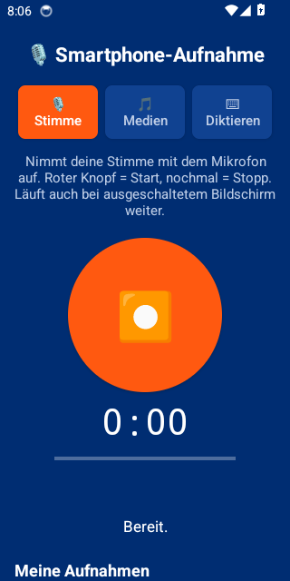
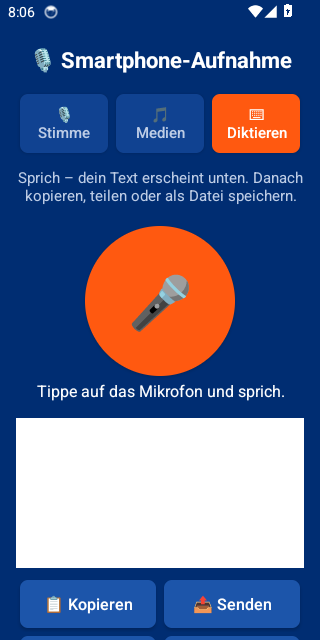

# 🎙 Smartphone-Aufnahme – Android-App

Eine kleine App für dein Android-Handy (z. B. Samsung) mit drei Funktionen:

| Bereich | Was es macht | Gespeichert als |
|---|---|---|
| 🎙 **Stimme** | Nimmt auf, was du ins Mikrofon sprichst | `.m4a`-Tondatei |
| 🎵 **Medien** | Nimmt den Ton auf, den das Handy gerade abspielt (Video, Radio-App, Sprachnachricht …) | `.m4a`-Tondatei |
| ⌨ **Diktieren** | Wandelt deine Sprache in Text um | Text zum Kopieren/Teilen oder `.txt`-Datei |

Alles bleibt **auf dem Handy**. Es wird kein Computer und kein Raspberry Pi gebraucht.
Jede Aufnahme lässt sich mit **📤 Senden** per WhatsApp, E-Mail usw. verschicken.
Design in den Farben der New York Mets (Blau und Orange).

 

## Installieren (einmalig, am Handy)

Die App kommt nicht aus dem Play Store, sondern direkt von hier. Android fragt deshalb einmal nach,
ob du das erlaubst.

1. Öffne am Handy in **Chrome** diesen Link:
   **https://github.com/marchens1977/Smartphone-Audio-Aufnahme/releases/download/neueste-version/Smartphone-Aufnahme.apk**
2. Chrome fragt eventuell, ob die Datei heruntergeladen werden soll → **Herunterladen** / **Trotzdem herunterladen**.
3. Tippe unten auf **Öffnen** (oder öffne die Datei über „Eigene Dateien“ → **Downloads**).
4. Android sagt: „Aus Sicherheitsgründen … unbekannte Apps …“ → **Einstellungen** → Schalter bei
   **Chrome** einschalten („Berechtigung von dieser Quelle“) → zurück.
5. **Installieren** tippen. Falls „Google Play Protect“ warnt: **Weitere Details** → **Trotzdem installieren**.
   (Die Warnung kommt, weil die App nicht aus dem Play Store ist.)
6. **Öffnen**. Die App heißt **Smartphone-Aufnahme** (oranges Mikrofon auf blauem Kreis).

**Neue Version installieren:** einfach denselben Link nochmal öffnen und installieren.
Deine Aufnahmen bleiben erhalten.

## Benutzen

### 🎙 Stimme aufnehmen
1. Oben **Stimme** wählen.
2. Orangen Knopf (●) tippen. Beim ersten Mal: Mikrofon **Zulassen** (und Benachrichtigungen **Zulassen**).
3. Sprechen. Uhr und Balken zeigen, dass aufgenommen wird. **⏸ Pause** ist möglich.
4. Grauen Knopf (■) tippen → die Aufnahme wird gespeichert und erscheint oben in der Liste.

Der Bildschirm darf dabei ausgehen. Oben in der Benachrichtigungsleiste siehst du „Aufnahme läuft“
und kannst dort auch **Pause** oder **Stopp** tippen.

### 🎵 Medienaudio aufnehmen
1. Oben **Medien** wählen.
2. Orangen Knopf (●) tippen. Android fragt, ob die App aufnehmen darf → **Jetzt starten**.
   (Bei neueren Handys: „Gesamter Bildschirm“ wählen.) Das fragt Android aus Sicherheitsgründen jedes Mal.
3. Jetzt die andere App öffnen und dort abspielen (Video, Podcast, Sprachnachricht …).
4. Zum Beenden zurück in die App und ■ tippen, oder in der Benachrichtigung **Stopp**.

**Wichtig – Grenzen von Android:**
- Aufgenommen wird nur der **Ton** (kein Bild), und **ohne** Mikrofon. Es ist also eine saubere Aufnahme.
- Manche Apps **sperren** die Aufnahme, z. B. Netflix, Spotify, oft auch WhatsApp-Anrufe und Telefonate.
  Dann ist die Aufnahme still. Das kann keine App umgehen.
- YouTube im Chrome-Browser, Radio-Apps, Podcasts und die meisten Spiele funktionieren normalerweise.

### 📤 Aufnahme senden (WhatsApp, E-Mail …)
1. In der Liste **Meine Aufnahmen** bei der gewünschten Aufnahme auf den orangen Knopf **📤 Senden** tippen.
2. Android zeigt die Auswahl „Senden mit …“:
   - **WhatsApp** → Kontakt oder Gruppe wählen → senden. Die Aufnahme kommt als Audiodatei an.
   - **E-Mail** (z. B. Gmail, Samsung E-Mail, GMX) → Empfänger eintragen → senden.
     Der Betreff ist schon ausgefüllt, die Aufnahme hängt als Anhang dran.
   - Auch Telegram, Signal, Google Drive, Bluetooth usw. sind möglich.

Tipp: Große Aufnahmen (über ca. 20 MB, also etwa 20 Minuten) nehmen viele E-Mail-Anbieter nicht an.
Dann lieber WhatsApp oder Google Drive nehmen.

### ⌨ Diktieren
1. Oben **Diktieren** wählen.
2. Orangen Mikrofon-Knopf tippen und sprechen. Der Text erscheint im weißen Feld. Die App hört weiter zu, bis du ■ tippst.
3. Satzzeichen sprechen: „Punkt“, „Komma“, „Fragezeichen“, „Ausrufezeichen“, „Doppelpunkt“,
   „neue Zeile“, „neuer Absatz“.
4. Den Text kannst du selbst korrigieren (ins Feld tippen).
5. Knöpfe darunter:
   - **📋 Kopieren** – danach z. B. in WhatsApp oder im Claude-Chat lange tippen → **Einfügen**.
   - **📤 Senden** – Text per WhatsApp, E-Mail usw. verschicken.
   - **💾 Speichern** – als Textdatei.
   - **🗑 Leeren** – Feld leeren.

Der Text bleibt erhalten, auch wenn du die App schließt.
Die Spracherkennung braucht **Internet** (sie läuft über die Spracherkennung des Handys, meist von Google).

## Wo sind meine Dateien?

In der App **Eigene Dateien** (Samsung) → **Interner Speicher**:
- Tonaufnahmen: **Music → Smartphone-Aufnahme**
  (Dateinamen wie `Sprache_2026-11-18_14-30-05.m4a` oder `Medien_…`)
- Diktate: **Documents → Smartphone-Aufnahme** (`Diktat_….txt`)

Die Tonaufnahmen findest du auch in Musik-Apps. In der App selbst kannst du sie anhören, teilen und löschen.

## Wenn etwas nicht klappt

| Problem | Lösung |
|---|---|
| „Mikrofon nicht erlaubt“ | Einstellungen → Apps → Smartphone-Aufnahme → Berechtigungen → Mikrofon → **Bei Nutzung der App zulassen** |
| Medien-Aufnahme ist still | Die abspielende App sperrt die Aufnahme (siehe oben), oder der Ton war stumm geschaltet. |
| Diktieren: „Keine Spracherkennung gefunden“ | Die App **Google** aus dem Play Store installieren/aktualisieren. |
| Diktieren: „Keine Internet-Verbindung“ | WLAN oder mobile Daten einschalten. |
| Installation: „App nicht installiert“ | Alte Version zuerst deinstallieren, dann neu installieren. |
| Aufnahme bricht im Hintergrund ab | Einstellungen → Apps → Smartphone-Aufnahme → Akku → **Nicht eingeschränkt**. |

## Technik (kurz erklärt)

- Geschrieben in **Java** (eine Programmiersprache für Android), ohne Zusatz-Bibliotheken.
- `app/src/main/java/…/MainActivity.java` – der Bildschirm (Knöpfe, Liste, Diktieren).
- `AufnahmeService.java` – nimmt im Hintergrund auf (Android nennt das „Vordergrund-Dienst“, darum die Benachrichtigung).
  Medienaudio nutzt die Android-Funktion „Audio Playback Capture“ (ab Android 10).
- `AacSchreiber.java` – wandelt den Ton in das platzsparende Format AAC (`.m4a`) um, ca. 1 MB pro Minute.
- `Speicher.java` – legt die Dateien im normalen Handy-Speicher ab.
- **GitHub baut die App automatisch** (`.github/workflows/app-bauen.yml`), sobald sich etwas ändert:
  Es testet sie auf einem simulierten Android-Handy und stellt die fertige `.apk`-Datei zum Herunterladen bereit.
  Eine `.apk` ist eine Installationsdatei für Android-Apps.
- `app/schluessel.keystore` – digitale Unterschrift der App. Gleiche Unterschrift = neue Versionen lassen sich
  über die alte installieren.

## Ältere Version für den Raspberry Pi

Im Ordner [`pi-version`](pi-version/) liegt die erste Version, bei der die Aufnahmen am Raspberry Pi
gespeichert wurden (wird im Moment nicht benutzt).
